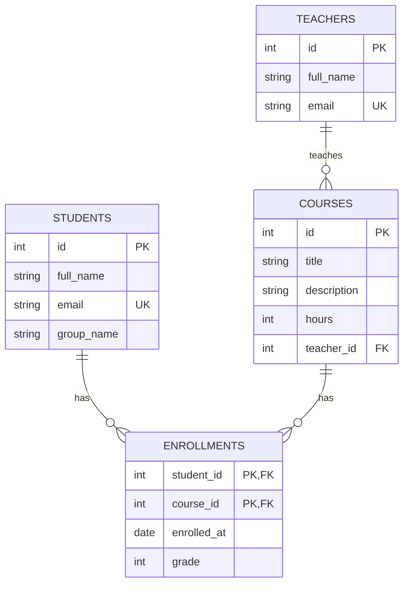

# lab-db

## ER-диаграмма

## Нормальная форма (3НФ)

Все атрибуты атомарные, повторяющихся групп нет, поэтому схема в 1НФ. В `enrollments` составной ключ (student_id, course_id), а enrolled_at и grade зависят от пары целиком, поэтому нет частичных зависимостей (2НФ). Данные о преподавателе, курсе и студенте хранятся в своих таблицах и не дублируются, а неключевые атрибуты зависят только от ключа, так что транзитивных зависимостей нет (3НФ).
